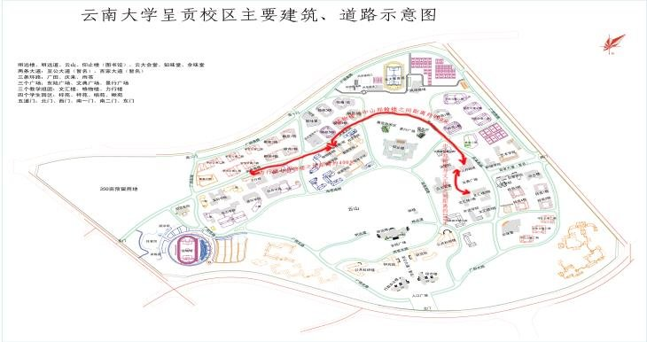

# 云南大学呈贡校区校园导游系统

数据结构实验六“图及其应用”的模块化 C++17 实现。以校园主要建筑和道路构成**带权无向图**，提供建筑查询、最短路径、最佳游览路线、全景环游和图遍历等功能。



## 1. 功能一览

| 菜单 | 功能 | 核心算法 | 对应要求 |
| --- | --- | --- | --- |
| 1 | 校园概览、建筑简介、相邻道路 | 邻接矩阵 | 建筑信息查询 |
| 2 | 任意两地点最短路径 | Dijkstra + 小根堆 | 问题（1） |
| 3 | 选择入口和途经点，生成最佳顺序 | Floyd + 状态压缩 DP | 问题（2） |
| 4 | 不重复走遍全部地点并回到入口 | 回溯 + 剪枝求哈密尔顿回路 | 问题（3） |
| 5 | 从指定地点进行 DFS / BFS | 深度优先、广度优先遍历 | 难度 A 的图遍历 |
| 6 | 两种最短路算法实测对比 | 计时与复杂度分析 | 思考题 |
| 7 | 帮助、图模型和算法说明 | — | 软件使用说明 |

附加特性：

- 22 个地点、46 条道路，全图连通；覆盖校门、教学楼、图书馆、食堂、宿舍、运动场、校医院、乘车点等。
- 所有路线均给出逐段里程、总路程和预计步行时间。
- 输入校验完整，`q` 可取消当前操作，空输入和非法编号不会导致崩溃。
- 终端 UTF-8 中文宽度对齐，支持 ANSI 颜色；重定向到文件时自动关闭颜色。
- 核心算法与界面分离，并提供 1797 项断言的自动化测试。

## 2. 快速开始

要求：支持 C++17 的编译器、CMake 3.16 及以上。

```bash
cmake -S . -B build -DCMAKE_BUILD_TYPE=Release
cmake --build build -j
./build/campus_tour
```

Windows（MinGW / Visual Studio）生成的可执行文件通常位于 `build/Release/campus_tour.exe`。

不使用 CMake 时：

```bash
g++ -std=c++17 -O2 -Iinclude src/*.cpp -o campus_tour
./campus_tour
```

运行测试：

```bash
./build/campus_tests
# 或
ctest --test-dir build --output-on-failure
```

## 3. 使用说明

启动后输入菜单编号 `0~7`：

1. **校园概览**：显示地点表；再输入编号查看简介、坐标和按距离排序的相邻道路。
2. **最短路径**：依次输入起点、终点编号，输出完整路径、每段距离、总路程和步行时间。
3. **最佳游览路线**：
   - 先从 5 个校门中选择入口；
   - 可选“经典打卡路线”，或自定义 1~8 个途经点；
   - 系统用 Floyd 预计算全源距离，再用状态压缩 DP 精确求出途经顺序；
   - 终点自由，不强制返回入口。
4. **全景环游**：选择入口后，搜索一条经过全部 22 个地点、每个地点只出现一次、最后回到同一入口的简单回路；出口就在入口旁边，因此用返回同一校门表示闭环。
5. **图的遍历**：选择起点，查看 DFS 与 BFS 的访问次序。箭头只表示访问先后，DFS 会回溯，并不代表实际步行路段。
6. **算法效率对比**：现场计时并解释 Dijkstra 与 Floyd 的适用场景。
7. **帮助**：查看操作方式、图模型、算法复杂度和思考题结论。

`q` 取消当前操作；主菜单输入 `0` 退出。

示例：查询北门到图书馆

```text
北门 → 明远楼 → 仰止楼（图书馆）
北门 → 明远楼          350 米
明远楼 → 仰止楼（图书馆） 550 米
总路程 900 米，步行约 12 分钟
```

## 4. 数据建模

### 4.1 图模型

- 顶点：校园地点，保存名称、类别、简介、是否校门、示意图坐标。
- 边：两地点之间的直接道路，权值为距离（米）。
- 存储：`std::vector<std::vector<int>>` 邻接矩阵，`kInf` 表示无边，对角线为 0。
- 所有道路均为双向，权值为正，因此 Dijkstra、Floyd 均适用。

### 4.2 距离估算

示意图中有一段红色参考线标注“步行约 400 米”，对应约 110 像素，比例约为 3.6 米/像素。按主要道路中心线量取像素长度，再乘以 1.1~1.3 的校内道路迂回系数，最后取整到 10 米，得到各边权值。例如：

- 北门—明远楼：350 米
- 明远楼—图书馆：550 米
- 西门—体育场：620 米
- 文汇楼—文渊楼：300 米

> 这些距离是教学演示用的近似值，不是测绘数据。若课程要求精确测量，可直接修改 [`src/CampusData.cpp`](src/CampusData.cpp) 中的 `road(...)` 参数，其余代码无需改动。

### 4.3 地点

校门 5 个：北门、西门、南一门、南二门、东门。

其他地点 17 个：明远楼、仰止楼（图书馆）、格物楼、力行楼、文汇楼、文渊楼、知味堂、余味堂、东陆广场、文典广场、桦苑、梓苑、楠苑、校医院、体育场、学生事务中心、校车乘车点。

## 5. 模块结构

```text
lab4/
├── CMakeLists.txt
├── README.md
├── assets/
│   └── campus_map.jpg
├── include/campus/
│   ├── CampusGraph.h        # 图 ADT：顶点、边、邻接矩阵
│   ├── CampusData.h         # 校园数据构建接口
│   ├── PathAlgorithms.h     # 遍历、最短路、路线规划、哈密尔顿回路
│   ├── ConsoleUI.h          # 终端显示与输入
│   └── CampusApp.h          # 菜单与业务控制
├── src/
│   ├── CampusGraph.cpp
│   ├── CampusData.cpp       # 22 个顶点、46 条道路的数据
│   ├── PathAlgorithms.cpp
│   ├── ConsoleUI.cpp
│   ├── CampusApp.cpp
│   └── main.cpp
└── tests/
    └── test_algorithms.cpp
```

分层关系：

```text
main.cpp
  └── CampusApp（业务/菜单）
        ├── ConsoleUI（输入输出）
        └── CampusGraph + PathAlgorithms（数据结构与算法）
              └── CampusData（校园数据）
```

算法层不依赖终端，因此测试可以直接调用，不经过菜单。

## 6. 核心算法

### 6.1 Dijkstra 单源最短路

- 使用邻接矩阵、`dist[]`、`prev[]` 和小根堆。
- 每次取出当前距离最小的未完成顶点，松弛其所有邻边；到达终点可提前结束。
- 通过 `prev[]` 反向还原路径。
- 时间复杂度：`O(V² + E log V)`（矩阵扫描 + 堆操作），空间 `O(V²)`。
- 要求边权非负；本图所有距离为正，满足条件。

### 6.2 Floyd 全源最短路

- 三重循环枚举中间点 `k`，同时维护 `distance[i][j]` 和 `next[i][j]`。
- `next` 矩阵用于在 `O(路径长度)` 时间内还原任意两点路径。
- 时间复杂度 `O(V³)`，空间 `O(V²)`。
- 可处理负权边（只要无负权环）；本程序主要利用它一次算出所有点对距离，供路线排序使用。

### 6.3 最佳游览顺序

设入口固定、途经点有 `k` 个。先通过 Floyd 得到入口和途经点之间的最短路闭包，再求“起点固定、终点自由”的最短访问顺序：

- `dp[mask][j]`：已访问集合 `mask`，最后停在途经点 `j` 的最短距离。
- 转移：`dp[mask | (1<<n)][n] = min(dp[mask][j] + dist[j][n])`。
- 时间复杂度 `O(2^k · k²)`，空间 `O(2^k · k)`。
- 本程序最多支持 12 个途经点，界面限制为 8 个，避免终端输出过长。

这与“贪心最近邻”不同：DP 给出的是精确最优顺序。

### 6.4 全景环游（哈密尔顿回路）

- 从入口开始回溯，递归选择未访问的相邻顶点。
- 剪枝一：剩余未访问点必须从当前点可达，否则立即回溯。
- 剪枝二：每个剩余点至少要有两条可用边（前驱、后继），否则不可能形成回路。
- 剪枝三：剩余点中必须至少有一个能直接回到入口。
- 哈密尔顿回路问题是 NP 完全问题，最坏时间复杂度为阶乘级；本图规模小且剪枝有效，每个校门通常几十到几百个状态即可找到解。
- 由于入口旁就是出口，程序用“回到同一校门”表示闭环。

### 6.5 DFS / BFS

- DFS 使用显式栈，按编号升序访问邻点；BFS 使用队列。
- 两者均记录 `visited[]`，时间复杂度 `O(V²)`（邻接矩阵扫描），空间 `O(V)`。
- 用于展示图的基本遍历能力，与最短路径、环游形成对照。

## 7. 思考题：Dijkstra 与 Floyd 的效率比较

| 维度 | Dijkstra | Floyd |
| --- | --- | --- |
| 解决问题 | 单源最短路（可只求单点对） | 全源最短路 |
| 典型复杂度 | 邻接表 + 堆：`O((V+E) log V)`；邻接矩阵：`O(V² + E log V)` | `O(V³)` |
| 空间 | `O(V)`（距离、前驱、堆） | `O(V²)`（距离矩阵，另加 next 矩阵） |
| 负权边 | 不允许 | 允许，但不能有负权环 |
| 实现难度 | 较高（堆、松弛） | 低（三重循环） |
| 适合场景 | 稀疏图、单源/单点查询 | 稠密图、需要所有点对距离 |

本题 `V=22`，两种算法都在微秒级。程序的分工是：

- **单次两点查询**用 Dijkstra，避免为一次查询计算全源矩阵；
- **最佳游览路线**需要入口与多个途经点之间的所有点对距离，先用一次 Floyd 更划算；
- **图的遍历**与最短路无关，使用 DFS/BFS。

本机 Release 模式下，菜单 6 的实测约为 Dijkstra 单点对 `0.3~0.4 μs`、Floyd 全源 `8~9 μs`（随机器变化）。这说明在小图上 Floyd 的常数很小，但若图规模增大，`O(V³)` 会迅速变得昂贵；反之，若只查一条路径，Dijkstra 不必承担全源计算的开销。

## 8. 测试

```bash
cmake --build build -j
ctest --test-dir build --output-on-failure
```

测试文件 [`tests/test_algorithms.cpp`](tests/test_algorithms.cpp) 覆盖：

- 顶点数、边数、连通性、矩阵对称性；
- DFS/BFS 覆盖全部顶点且不重复；
- Dijkstra 的已知距离、路径合法性和同点查询；
- Floyd 与 Dijkstra 的全点对距离一致性、路径还原合法性；
- 最佳游览顺序访问全部途经点、分段连续、总距离正确，并用全排列暴力验证 DP 的最优性；
- 每个校门都能找到哈密尔顿回路，且不重复、覆盖全部地点、回入口、总距离正确；
- 不连通图的不可达路径、空路径和失败路线规划。

当前结果：

```text
全部测试通过（1797 项断言）
```

## 9. CDIO 四个阶段

### C（Conceive，构思）

- **背景**：新生和家长不熟悉呈贡校区，需要按建筑功能、距离和入口快速找到路线。
- **用户**：师生、访客、新生；使用终端菜单，无需图形界面基础。
- **目标**：把校园抽象成带权无向图，回答“怎么走最短”“一天怎么逛”“能否不走回头路逛完全校”。
- **需求**：
  1. 建筑信息与相邻道路查询；
  2. 任意两点最短路径；
  3. 用户指定入口，生成最佳游览路线；
  4. 不重复经过所有建筑并回到入口；
  5. 图遍历演示、算法对比、友好的帮助文档；
  6. 输入健壮，异常不崩溃。
- **约束**：距离从示意图估算；终端环境；C++17 标准库；不依赖第三方库。

### D（Design，设计）

- **数据设计**：`Place` 保存业务信息；`CampusGraph` 用邻接矩阵保存 22 个顶点和 46 条无向边，边权为正整数米。
- **模块设计**：数据、图 ADT、算法、界面、业务控制五层分离；算法层不依赖 UI，便于单元测试。
- **算法设计**：
  - 两点路径 → Dijkstra；
  - 多途经点排序 → Floyd 闭包 + 状态压缩 DP；
  - 全景点环游 → 回溯 + 三重剪枝；
  - 基本遍历 → 显式栈 DFS、队列 BFS。
- **界面设计**：编号菜单、表格对齐、颜色、分段路线、错误提示、`q` 取消、自动关闭 ANSI 颜色。
- **异常设计**：非法顶点、正权校验、重复边、不可达、途经点重复等均有明确处理。

### I（Implement，实现）

- 使用 C++17、CMake、标准库容器与算法，无第三方依赖。
- 先实现图 ADT 和数据，再实现算法并写测试，最后接入菜单；算法和界面可独立验证。
- 关键实现：
  - `CampusGraph::addRoad` 保证无自环、正权、无重复边；
  - `dijkstra` 用 `prev[]` 还原路径；
  - `floydWarshall` 用 `next[][]` 还原路径；
  - `planBestTour` 用位掩码 DP；
  - `findHamiltonianCycle` 用可达性、剩余度数和回入口条件剪枝。
- 编译选项开启 `-Wall -Wextra -Wpedantic`，构建无警告。

### O（Operate，运行）

- 构建：CMake 一条命令；提供无 CMake 的 `g++` 备用命令。
- 验收路径：
  1. 菜单 1 查询“明远楼”；
  2. 菜单 2 查询“北门 → 图书馆”，应得到 900 米；
  3. 菜单 3 从北门走经典路线；
  4. 菜单 4 从任一校门完成 22 点环游；
  5. 菜单 5 查看 DFS/BFS；
  6. 菜单 6 查看算法实测；
  7. 菜单 7 阅读帮助。
- 测试：`ctest` 全通过，共 1797 项断言。
- 运行反馈：路线分段清楚，非法输入有提示；终端宽度不足时可滚动查看，不影响结果。
- 局限与改进：距离为估算值；哈密尔顿搜索为指数级；终端不能显示地图图片，后续可用 Qt/Web 前端复用算法层，或接入真实 GIS 数据与实时路况。

## 10. 项目分工模板

> 个人完成时可将三行合并为本人；团队完成时请替换为实际姓名，并按真实贡献调整。

| 成员 | 角色 | 主要工作 | 交付物 |
| --- | --- | --- | --- |
| 待填写 | 组长 / 数据与图模型 | 需求分析、校园数据测量、`CampusGraph`、整合 | 图数据、CDIO 构思与设计 |
| 待填写 | 算法 | Dijkstra、Floyd、DP、哈密尔顿回路、测试 | 算法模块、测试报告 |
| 待填写 | 界面与文档 | 菜单、输入校验、帮助、README、演示 | 可执行程序、使用文档 |

建议团队协作方式：接口先定稿，数据与算法并行；每次合并前跑 `ctest`；界面只依赖算法接口，避免互相阻塞。

## 11. 提交建议

- 提交源码、`CMakeLists.txt`、`README.md`、`assets/` 和测试；不要提交 `build/`。
- 实验报告可直接引用第 4、6、7、9 节，并补充实际运行截图、成员分工和答辩记录。
- 若教师要求固定顶点数或指定建筑，可只修改 [`src/CampusData.cpp`](src/CampusData.cpp)，算法与界面无需调整。
